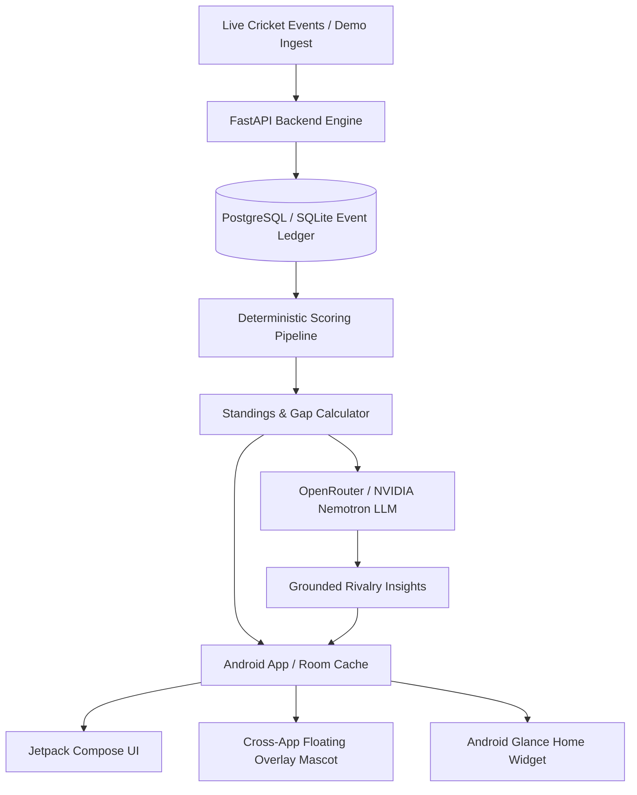

# 🏏 FanLens AI — Real-Time Live Cricket Companion & Rivalry Intelligence

[](https://github.com/riddhibantia/FanLensAI)
[](https://developer.android.com/jetpack/compose)
[](https://fastapi.tiangolo.com)
[](https://openrouter.ai)
[](LICENSE)

> **Built for Dream11 Forward Deployed Engineer (FDE) Intern Assignment**  
> *An AI-powered live companion solving the "context-switching & banter latency" problem in private fantasy cricket leagues.*

---

## 📌 Problem Statement

During live matches, over **150M+ sports fans** play private fantasy leagues with friends while watching the match broadcast. Whenever a boundary is hit or a wicket falls, fans face a frustrating loop:
1. **Context Switching:** Fans minimize or exit the live video stream on JioCinema/Hotstar to open fantasy apps.
2. **Missing Context:** Static leaderboard tables show points, but not *why* ranks shifted or who has captaincy multipliers on the current bowler/batter.
3. **Lost Live Momentum:** Friends spend time manually calculating point deltas instead of enjoying the match and banter.

---

## 💡 The Solution: FanLens AI

**FanLens AI** introduces a non-intrusive, cross-app live sports companion centered around **Googly** — an interactive cricket-ball mascot:

* **🏏 Cross-App Floating Mascot (`Googly`):** A persistent, draggable Android overlay (`WindowManager` + `TYPE_APPLICATION_OVERLAY`) that floats above any streaming app or social app without obscuring video controls.
* **⚡ Live Match & Fantasy Micro-Pill:** Real-time dual display showing live cricket scores (`IND 172/4 (18.2 ov)`) along with your live fantasy rank & points (`#2 · 284 pts · Δ+18`).
* **🧠 Rivalry Intelligence:** Tapping the mascot provides instant grounded AI breakdowns explaining *why* standings swung and what exact match events are needed to overtake the leader:
  > *"Bumrah’s 19th-over wicket gave Rahul +25 pts, widening the gap to 28 pts. If Kohli hits 1 boundary in the 20th over, you overtake him into #1."*
* **🛡️ Zero-Hallucination Architecture:** The server's scoring engine deterministically computes all points, rankings, and event ledgers. The AI is strictly a natural-language explainer—never an author of points or ranks.

---

## 🏗️ Architecture & Tech Stack



### **Android Client**
* **Language & Framework:** Kotlin 2.0, Jetpack Compose, Material 3
* **Overlay Engine:** Android `WindowManager` with native `FrameLayout` gesture interceptor & `FLAG_NOT_TOUCH_MODAL`
* **Local Persistence:** Room Database cache with reactive Kotlin Coroutines & Flow
* **Preferences:** Android Jetpack DataStore

### **Backend & AI Pipeline**
* **Framework:** Python 3.12, FastAPI, SQLAlchemy, Pydantic
* **AI Model:** OpenRouter API (`nvidia/nemotron-3-ultra-550b-a55b:free`)
* **Scoring Integrity:** Deterministic point ledger keyed by `(event_id, fantasy_team_id, player_id, ruleset_version)` ensures 100% idempotent replays.

---

## 📱 Core Features

| Feature | Description |
|---|---|
| **Live Match Dock** | Real-time match scorecard (IND vs AUS) + Head-to-Head fantasy rivalry bar. |
| **Floating Mascot Overlay** | Draggable companion with bobbing animation that stays visible over live video. |
| **Googly AI Lab** | Dedicated chat interface to interrogate point breakdowns, player stats, and "what-if" match scenarios. |
| **Private Circles & Rosters** | Create and join private circles with invite codes; manage 11-player fantasy rosters with Captain (2x) and Vice-Captain (1.5x) multipliers. |
| **Two Companion Modes** | `ALWAYS_REACTIVE` (proactive mascot reactions to wickets/sixes) or `TAP_TO_ACTIVATE` (silent tap-to-expand mode). |

---

## 🚀 Quickstart & Setup

### Prerequisites
* Android Studio Ladybug or newer / JDK 17
* Android Device or Emulator running Android 8.0+ (API 26+)
* Python 3.11+ (for running the local backend)

### 1. Run the Backend
```bash
cd backend
python -m venv .venv
source .venv/bin/activate  # On Windows: .venv\Scripts\activate
pip install -r requirements.txt
alembic upgrade head
python scripts/seed_demo.py
uvicorn app.main:app --host 0.0.0.0 --port 8000 --reload
```

### 2. Build & Run the Android App
```bash
cd android
./gradlew assembleDebug

# Install on connected device
adb install -r app/build/outputs/apk/debug/app-debug.apk
```

---

## 🔒 Responsible Product & Design Principles
1. **Zero Real-Money Gambling:** No wagering, entry fees, or payouts. Designed exclusively for social friend groups and private circles.
2. **Grounded Explanations:** The LLM is never given authority to compute or guess scores. All arithmetic is verified by the backend scoring ledger.
3. **Respectful Android UX:** Overlay complies with Android background execution limits and allows one-tap dismissal at all times.

---

## 👩‍💻 Author
**Riddhi Bantia**  
*Forward Deployed Engineer Intern Candidate — Dream11*  
GitHub: [@riddhibantia](https://github.com/riddhibantia)
